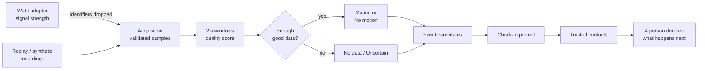
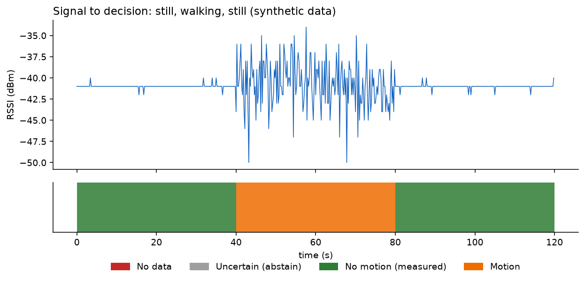
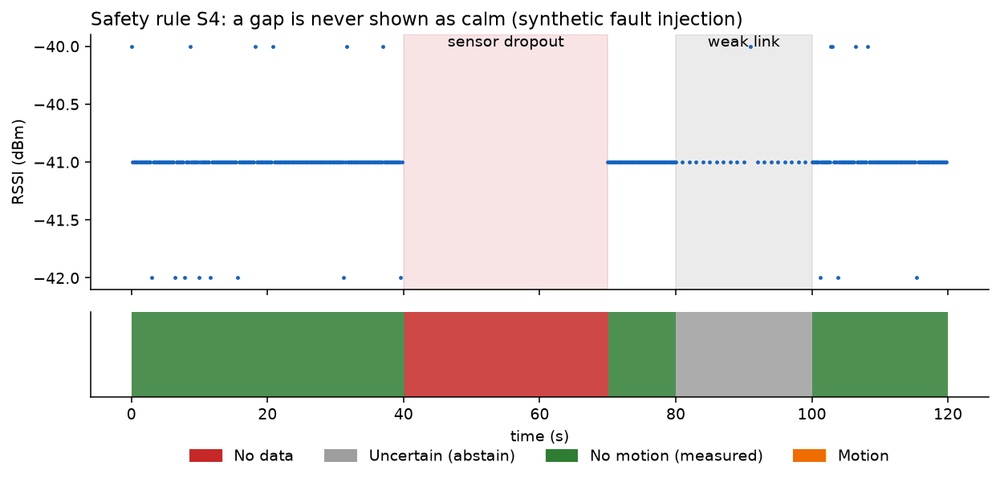
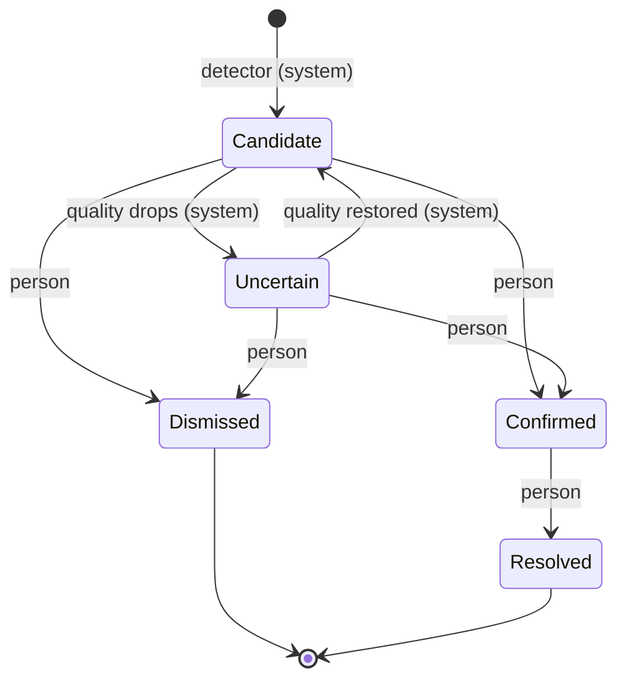
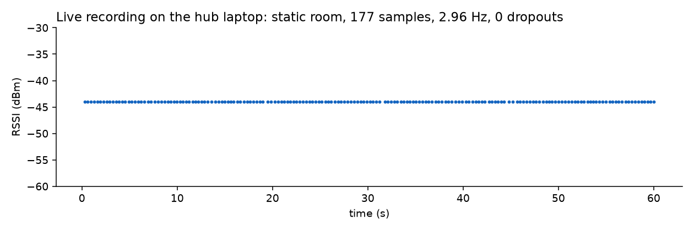
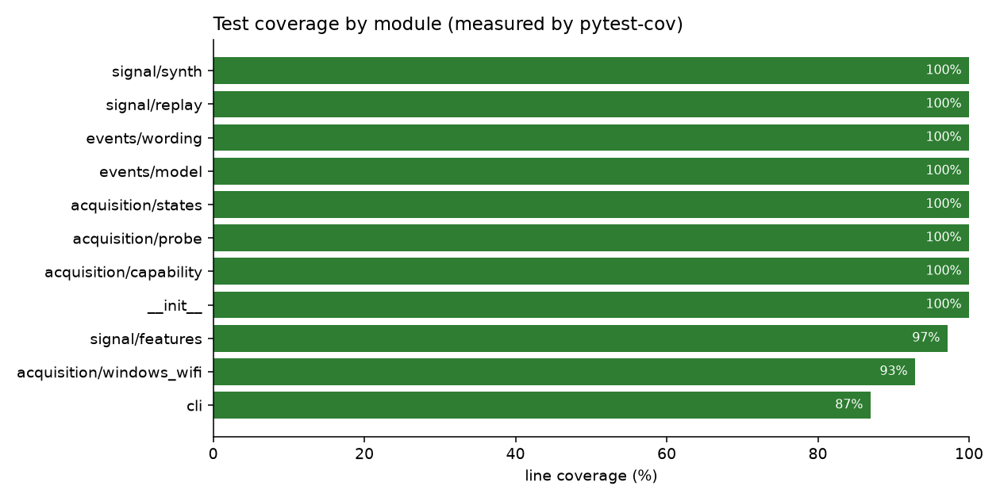

# PGuard

**Camera-free safety monitoring from the Wi-Fi a home already has.**

PGuard watches how the home Wi-Fi signal changes to notice movement, long stillness and
possible falls, and brings a chosen person into the loop quickly. It is built on one rule:

> PGuard reports what it measured, how sure it is, and what it cannot know.


---

## Highlights

- **Private by design.** Network name, router address and device MAC address are discarded
  the moment a reading is taken, so they never reach storage, logs or alerts.
- **Honest about data.** Every 2-second window carries a quality score. Missing, stale or
  corrupt input becomes *No data* or *Uncertain*, never *No motion*.
- **Hardware-aware.** A capability check reports exactly which features this laptop and
  router support, and switches off anything the hardware cannot back up.
- **People decide.** Only a person can confirm an event. Alert wording is checked
  automatically for accusatory or diagnostic terms.
- **Engineered to last.** Test-first development, 97% line coverage, static security
  analysis, dependency audit, non-root container and cross-platform CI.

## How it works



Steps up to *Event candidates* run on the home laptop, so raw signal never leaves the home.

### From signal to decision

The pipeline turns raw signal strength into one state per window. Still, then walking, then
still again:



### A gap is never shown as calm

Fault injection: a 30-second sensor dropout is reported as **No data**, and a weak link as
**Uncertain**. Neither can be mistaken for a quiet home.



### Events need a person to confirm them



Every transition is appended to the event's history with the actor and time.

## Measured on real hardware

Hub laptop: MediaTek Wi-Fi 6E MT7922, Windows 11, 5 GHz. A 60-second recording of a static
room, with zero dropped readings ([raw data](docs/data/live-laptop-2026-10-27.jsonl)):



| Measurement | Result |
|---|---|
| Capability tier | Tier 1: signal strength (RSSI) |
| `netsh` sample rate | 2.8 to 5.0 Hz across runs |
| Native Wi-Fi API sample rate | 19.4 Hz |
| Dropped readings | 0 in every run |
| Static-room stability | Constant reading over 60 s |

Tier 1 provides presence and motion, inactivity watch and fall candidates. Breathing needs
channel state information (CSI), which requires an Intel AX200/AX210 card on Linux, so
PGuard keeps it switched off on this hub. **Next milestone:** the labeled movement test
(`pguard probe-states`) that verifies walking and stillness separate on this hardware.

## Quality



| Check | Tool | Result |
|---|---|---|
| Unit and regression tests | pytest | all passing |
| Line coverage | pytest-cov | 97% |
| Lint | ruff | clean |
| Static security analysis | bandit | 0 issues |
| Dependency vulnerabilities | pip-audit | none found |
| Container | Docker | builds, runs as non-root (uid 10001) |
| CI | GitHub Actions | Ubuntu + Windows, Python 3.12 and 3.13 |

## Quick start

```powershell
python -m venv .venv
.venv\Scripts\python -m pip install -e ".[dev]"
.venv\Scripts\python -m pytest --cov=pguard

# Measure this laptop's sensing capability (writes probe-report.json)
.venv\Scripts\pguard probe --seconds 15

# Labeled movement test: sit still, walk, lie still (about 85 s, beeps at each step)
.venv\Scripts\pguard probe-states
```

Regenerate every figure from the recordings and the code:

```powershell
.venv\Scripts\python -m pip install -e ".[dev,docs]"
.venv\Scripts\python -m pytest --cov=pguard --cov-report=json:coverage.json
.venv\Scripts\python tools\make_figures.py
```

Docker (replay and synthetic modes; live sensing needs a Windows host):

```bash
docker build -t pguard .
docker run --rm pguard --help
```

## Project layout

| Path | Purpose |
|---|---|
| `src/pguard/acquisition` | Wi-Fi reader, capability check, probe, labeled movement test |
| `src/pguard/signal` | Windowed features, quality scoring, replay and synthetic sources |
| `src/pguard/events` | Event state machine and alert wording check |
| `tests/` | Unit, regression and fault-injection tests |
| `tools/make_figures.py` | Builds every figure in `docs/img` |
| `docs/adr` | Architecture decision records |

## Roadmap

1. Feasibility probe and labeled movement test (in progress)
2. Signal pipeline with quality scoring (done)
3. Movement timeline, personal baseline, inactivity watch
4. Fall candidates, check-in prompt, escalation ladder, audit log
5. Email and Telegram/ntfy alerts with delivery tracking, heartbeat
6. Home, Away, Sleep and Guest modes, silent duress alert
7. Accessible dashboard and caregiver web app

## Responsible use

PGuard is a monitoring aid, not a medical device, emergency service or certified alarm
system. Only the monitored adult can switch it on, sensing is always visible, and any
household member can pause it.
